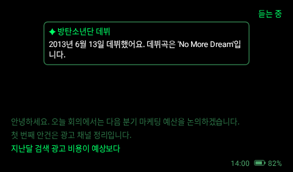
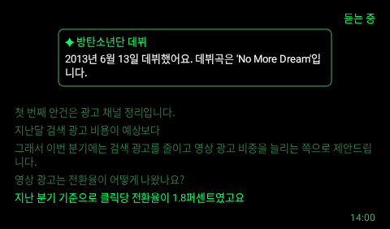
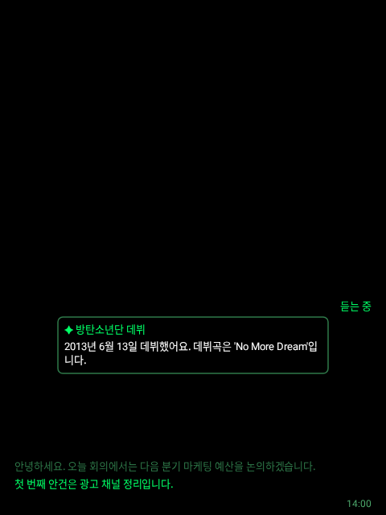
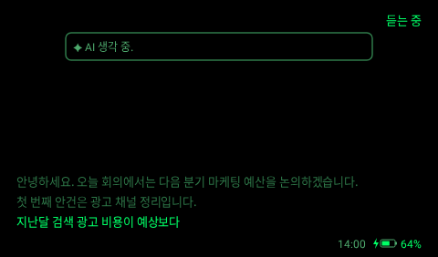
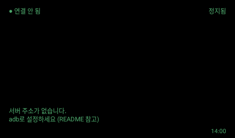
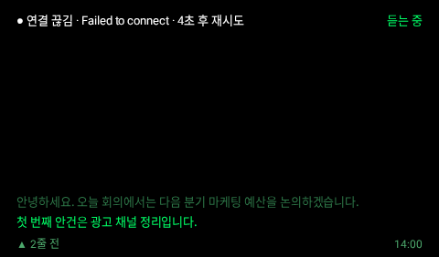

# rokid-conversate

Rokid 안경에서 대화를 실시간 자막으로 띄우는 앱. Even Realities G2 의 대화 지원 기능(Conversate)을 목표로 하고, 지금은 1단계인 **실시간 자막**까지 있다.

```
[안경 APK (Kotlin)]  마이크 16kHz PCM ─ WebSocket ─▶ [서버 (Python, faster-whisper)]
        ▲                                                   │
        └───────────────── 자막 ◀───────────────────────────┘
iPhone 은 개인용 핫스팟으로 인터넷만 준다 (폰 앱 없음)

**핫스팟 자동 켜기 (iPhone 단축어, 실기 확인):** 단축어 → 자동화 → 새로운 자동화 → 블루투스 → Rokid 안경 → 연결될 때 → 즉시 실행 → 동작 "개인용 핫스팟 켜기". 안경을 켜면 블루투스로 붙으면서 핫스팟이 켜지고, 앱이 Wi-Fi 를 켜서 저장된 핫스팟에 붙는다. (애플 인스턴트 핫스팟은 애플 기기끼리만 됨)
```

| 폴더 | 내용 |
|---|---|
| `glasses/` | 안경 앱. 화면 크기·여백·입력은 [rokid-glass-ios-navigation](https://github.com/ChoRockKim/rokid-glass-ios-navigation) 의 안경 앱과 같다 |
| `server/` | WebSocket 서버. 말소리를 문장으로 끊어 Whisper 로 받아쓴다 |
| `docs/` | [조사 요약](docs/00-summary.md) (G2 Conversate, Rokid 근거, Whisper 실측), [프로토콜](docs/protocol.md), [Rokid 앱 개발 노트](docs/rokid-dev-notes.md) |

## 화면

| 듣는 중 + AI 요약 | 대화가 길 때 | 안경 화면 전체 (480x640) |
|---|---|---|
|  |  |  |

| AI 생각 중 (충전 중) | 말 기다리는 중 (배터리 부족) | 서버 설정 전 | 연결 끊김 + 지난 자막 보는 중 |
|---|---|---|---|
|  |  |  |  |

[Paparazzi](https://github.com/cashapp/paparazzi) 가 실제 그리기 코드로 그린 것 (`./gradlew :app:recordPaparazziDebug`).

- 480x282 논리 단위로 그리고 실제 화면에 비율을 유지한 채 맞춰 줄여 아래 가운데에 둔다. 여백 18, 위 줄 기준선 27, 아래 줄 272. 배경·테두리 없음 (검정 = 안경에서 투명).
- 위쪽 약 30% (논리 y 36~120) 는 자막을 쓰지 않고 **AI 결과 자리**로 둔다. 너비 70% 의 테두리 카드로 가운데에, AI 가 답을 만드는 동안은 `생각 중…`.
- 오른쪽 아래: 시각, 배터리 (충전 중이면 번개·초록, 15% 이하면 흰색).
- AI 요청: 질문으로 보이는 문장(`?`, 언제·누구·뭐…, ~더라·~나요)은 바로, 그 밖에는 새 글자 20자·15초마다 (비용: 판단은 `gpt-6-luna`, 웹 검색은 바뀌는 정보일 때만). 답에 붙는 링크·출처는 지운다. 서버가 대화를 OpenAI 에 보내 용어 설명·검색 답·인물/회사 배경 중 도움이 될 것 하나를 받아 띄운다 (`OPENAI_API_KEY` 가 있을 때만, 15초에 한 번까지).
- 자막은 13 크기. 가장 최근 줄만 밝은 초록, 지나간 줄은 연한 초록. 넘치면 오래된 것부터 위로 잘린다.

## 사전 노트

대화 전에 iPhone 브라우저에서 `https://server-production-24bc.up.railway.app/notes` 를 열어 만날 사람·목적·용어·숫자를 적어 두면 AI 가 참고한다 (처음 한 번 `CONVERSATE_TOKEN` 입력, 이 기기에 기억). 대화가 노트 내용에 닿으면 노트를 꺼내 보여 주고, 답변도 노트를 먼저 본다. 서버 볼륨 `/data/notes.json` 에 저장, 8000자까지.

## 대화 기록·요약

iPhone 에서 `https://server-production-24bc.up.railway.app/history`. 확정 자막이 3분 동안 없으면 대화 하나가 끝난 것으로 보고, 제목·요약·할 일을 만든다 (`SUMMARY_MODEL`, 기본 gpt-6.1-terra). 자막·번역·AI 카드를 글로만 볼륨 `/data/conversations` 에 저장 (소리는 저장 안 함). `HISTORY=0` 으로 끔.

## 조작

앱을 켜면 **모드 메뉴**가 뜬다. 맨 아래 **설정**에서 "한국어 자막"을 끄면 외국어 번역 자막만 뜨고 AI 카드는 그대로 (배터리: 화면이 대부분 비어 어두워짐). 이때 위아래로 쓸면 지난 AI 카드를 넘겨 본다 (최근 20개, 카드에 "2/5"). 다시 메뉴로: 듣는 중 두 번 탭 (쓸기로 고르고 탭으로 시작, 마지막에 쓴 모드에서 시작). 모드마다 소리를 받는 방식이 다르다 (`glasses/.../Mode.kt`, `server/conversate/modes.py`, 실기 미확인):

| 모드 | 마이크 | 소리 보내기 (안경) | 문장 자르기 (서버) | AI 카드 |
|---|---|---|---|---|
| 일상 | 처리 채널 ↔ 원래 캡슐 자동 | 소음의 3배, 0.2초 | 0.7초 쉬면 | 그대로 |
| 수업 · 영화 | 원래 캡슐 4개만 (먼 소리) | 2배, 0.1초, 2초 여유 | 0.9초 쉬면, 최대 15초 | 용어·개념·인물 위주, 되묻기 제안 없음, 30초에 한 번 |
| 미디어 (안경 스피커로 듣는 블루투스 소리) | 마이크가 아니라 스피커로 나가는 신호(에코 참조 채널 6·7) | 1.5배, 3초 여유 | 0.5초 쉬면, 최대 8초 | 끔 |

배터리: 말소리 근처만 Opus 로 압축해 보내고(조용할 땐 안 보냄), 3분 동안 소리가 없으면 서버 연결을 끊었다가 소리가 나면 다시 붙는다(위쪽에 "절전 대기"). 아무것도 안 띄울 땐 화면 밝기를 최소로. 오른쪽 아래 `−6%/h` 는 모드 시작 뒤 시간당 배터리 소모 (시작하면 "소모 측정 중", 3분 지나고 1% 이상 줄면 숫자). 실기 미확인.


| 입력 | 동작 |
|---|---|
| (없음) | 앱을 켜면 바로 듣기 시작, 앱을 나가면 멈춤 |
| 10초 동안 말이 없으면 | 자막을 숨김. 새 말이 들어오거나 탭·쓸기(링 포함)를 하면 다시 보임 |
| 뒤로 쓸기 (DPAD 왼쪽·위, R08 링 뒤로) | 지난 자막 |
| 앞으로 쓸기 (DPAD 오른쪽·아래, R08 링 앞으로) | 최신 쪽으로 |
| 뒤로 (더블탭, R08 링 더블탭) | 지난 자막을 보던 중이면 최신으로, 아니면 모드 메뉴로. 메뉴에서는 앱 종료 |

**R08 링:** [R08 Access Bridge](https://github.com/Anezium/R08-Access-Bridge) 를 쓰는 경우, 네비 앱과 같은 방식이다. 화면 전체가 포커스·클릭·스크롤 가능한 접근성 노드 하나라서, 링 앞/뒤 = 스크롤 앞/뒤 = 다음/이전, 링 탭 = 클릭 = 선택, 링 더블탭 = 전역 뒤로. 브리지 없이 Stable 모드(미디어 키)로 들어와도 같은 뜻으로 받는다. 위로 쓸기 제스처는 앞으로. (실기 미확인)

## 실행

### 1. 서버
```bash
cd server
python3 -m venv .venv && .venv/bin/pip install -r requirements-dev.txt
export CONVERSATE_TOKEN=$(openssl rand -hex 16)   # 안경에도 같은 값
export OPENAI_API_KEY=sk-...                       # 위쪽 AI 결과용 (없으면 자막만)
.venv/bin/uvicorn conversate.main:app --factory --host 0.0.0.0 --port 8000
```
- 처음 받아쓸 때 Whisper 모델을 내려받는다 (`small` 약 500MB). 설정은 `server/.env.example`.
- AI 결과 모델은 `ASSIST_MODEL` (기본 `gpt-6.1-terra`, 더 싸게 `gpt-6-luna`), 웹 검색은 `ASSIST_WEB_SEARCH=0` 으로 끔.
- 안경이 서버에 닿아야 한다. 같은 핫스팟에 노트북을 붙여 `ws://<노트북 IP>:8000/ws` 로 쓰거나, 밖에서는 ngrok 등으로 `wss://` 주소를 만든다.
- 안경 없이 점검: `ffmpeg -i 녹음.m4a -ar 16000 -ac 1 -sample_fmt s16 a.wav` 후
  `.venv/bin/python tools/send_wav.py a.wav --url ws://localhost:8000/ws` (실시간 속도로 보내고 자막을 출력)

### 배포 (Railway)
Railway 프로젝트 `rokid-conversate` → 서비스 `server` (GitHub `main` 의 `/server` 를 Dockerfile 로 빌드, `server/**` 가 바뀌면 다시 배포).
주소: `wss://server-production-24bc.up.railway.app/ws`, 헬스체크 `/health`.
변수: `CONVERSATE_TOKEN`, `OTA_UPLOAD_TOKEN`, `OTA_DIR=/data/ota` (볼륨 `ota-data` 를 `/data` 에), `WHISPER_MODEL=small`, `WHISPER_LANGUAGE=ko`, `ASSIST_MODEL`, `ASSIST_WEB_SEARCH`. AI 영역을 켜려면 `OPENAI_API_KEY` 를 대시보드에서 추가.

### 2. 안경 앱 (처음 한 번은 케이블로)
처음 설치부터 고정 키로 서명한 릴리스 APK 를 쓴다. 그래야 이후 OTA 업데이트가 덮어 설치된다.
```bash
cd glasses
echo "sdk.dir=/path/to/android-sdk" > local.properties   # platforms;android-36
export RELEASE_KEYSTORE=~/.config/rokid-conversate/release.keystore   # 없으면 처음 실행 때 만든다. 꼭 백업
export RELEASE_KEYSTORE_PASS=...
scripts/release.sh 1 0.1.0
PKG=com.chorockkim.conversate
adb install -r -i $PKG build/rokid-conversate-0.1.0.apk                # -i: 이 앱이 자기 설치자 → 업데이트에 확인 창 없음
adb shell pm grant $PKG android.permission.RECORD_AUDIO               # 마이크
adb shell appops set $PKG REQUEST_INSTALL_PACKAGES allow              # 업데이트 설치 허용
adb shell appops set $PKG SYSTEM_ALERT_WINDOW allow                   # 업데이트 뒤 앱 다시 띄우기
adb shell pm grant $PKG android.permission.WRITE_SECURE_SETTINGS    # 앱 켤 때 Wi-Fi 자동으로 켜기 (없으면 앱 화면에 "켜지 못함" 카드, 탭하면 시스템 설정)
```
Wi-Fi 자동 켜기: adb 권한(`WRITE_SECURE_SETTINGS`) 없이도 되도록 **Wi-Fi 켜기 도우미** 앱(`glasses/wifihelper`, 화면 없음)을 한 번 설치한다. 안드로이드는 targetSdk 28 이하 앱에만 Wi-Fi 켜기를 허용하는데, 본앱은 무확인 OTA 때문에 28로 낮출 수 없어서 따로 뺐다. 빌드: `./gradlew :wifihelper:assembleRelease -PRELEASE_KEYSTORE=… -PRELEASE_KEYSTORE_PASS=…` (실기 확인: 보이지 않는 화면 방식으로 켜짐, 2026-11-06)

서버 주소·토큰 설정 (안경에 키보드가 없어서 adb 로 넣는다. 저장되므로 한 번만):
```bash
adb shell am start -n com.chorockkim.conversate/.MainActivity --es config "'CONVERSATE:url=ws://172.20.10.2:8000/ws;token=<토큰>'"
```
빌드할 때 넣어 두려면 `local.properties` 에 `conversateUrl=` / `conversateToken=` (APK 에 토큰이 들어가니 남에게 주지 말 것).
`CONVERSATE:url=…;token=…` 문자열은 나중에 QR 코드로 설정할 때도 같은 형식을 쓸 생각이다.

### 3. 업데이트 (OTA, 안경에서 누를 것 없음)
```bash
export OTA_UPLOAD_TOKEN=...   # Railway 변수 OTA_UPLOAD_TOKEN
scripts/release.sh 2 0.2.0 --upload   # versionCode 는 매번 올린다
```
- 안경은 **앱을 켤 때 한 번** (켠 뒤 서버에 처음 연결됐을 때) `/app/latest` 를 확인한다. 새 버전이면 받아서 sha256 을 확인하고 **확인 창 없이 설치**한 뒤 앱을 다시 띄운다 (Android 12 의 `USER_ACTION_NOT_REQUIRED`, 자기 자신 업데이트만 가능).
- 확인은 앱을 켤 때라, 새 버전이 있으면 바로 설치하고 다시 켠다. 진행 상황은 아래 줄에, 받을 버전은 오른쪽 아래 `새 버전 0.2.0`.
- 위의 `-i` 설치나 `appops` 가 빠졌으면 안드로이드가 설치 확인 창을 띄운다 (그때는 한 번 눌러야 함).
- 서버 쪽: `PUT /app/upload` (업로드 토큰), `GET /app/latest`·`/app/download` (안경 토큰). APK 는 Railway 볼륨 `/data/ota` 에 하나만 보관.
- 다른 안경 앱도 같은 서버로 업데이트한다: `/apps/<이름>/latest`·`/download` (토큰 없이 공개, 서버 토큰이 든 APK 는 올리지 말 것), `PUT /apps/<이름>/upload` (같은 업로드 토큰). 이름은 `OTA_PUBLIC_APPS` (기본 `rokid-youtube`), 파일은 `/data/ota/<이름>/`.
- **rokid-lens 사진 번역:** `POST /lens/translate?target=ko` (본문 JPEG) → Gemini가 글자를 읽고 번역해 문단 목록으로 돌려준다. 변수 `GEMINI_API_KEY` (없으면 503), 선택 `GEMINI_MODELS` (기본 `gemini-3.5-flash,gemini-3.5-flash-lite`, 앞 모델이 없거나 한도면 다음 것). 인식 진단용으로 마지막 사진 1장만 메모리에 두고 `GET /lens/last` (업로드 토큰)로 볼 수 있다. Lens APK 에는 토큰이 없어서 무료 한도 보호용으로 주소당 분당 20장, 하루 전체 1000장으로 제한한다.
- **릴리스 키를 잃어버리면 OTA 로는 더 이상 업데이트할 수 없다** (지우고 케이블로 다시 설치).
- 실기 미확인: Rokid 펌웨어가 확인 창 없는 설치와 업데이트 뒤 자동 실행을 허용하는지.

### 테스트
```bash
cd server && .venv/bin/python -m pytest          # 말소리 끊기, WebSocket, 인증
cd glasses && ./gradlew :app:testDebugUnitTest   # 프로토콜, 자막 목록, 입력, 재연결, R08 접근성
```

## 확인 상태
- AI 결과: 가짜 모델로 흐름 테스트, OpenAI 호출은 잘못된 키로 401 까지만 확인 (실제 응답 품질·지연은 미확인).
- 확인함: 서버 테스트, 한국어 음성으로 Whisper 받아쓰기 (CPU `small`, 말이 끝나고 약 5초 뒤 확정 자막), 안경 앱 빌드·테스트·화면 미리보기.
- **안경 실기 미확인:** 마이크를 서드파티 앱이 계속 쓸 수 있는지, Wi-Fi 로 오디오를 계속 보낼 때 배터리, 터치패드·R08 키, 화면 크기.
- 실기에서 볼 것: `adb logcat -s Conversate MicStreamer` (오디오 소스, 연결 상태), 서버의 `level` 메시지로 소리가 들어오는지.

## 다음 단계
1. 실기: 마이크 → 서버 → 자막 한 바퀴, 배터리 소모 측정
2. 실제 키로 AI 결과 품질·지연 확인, 프롬프트 다듬기
3. 대화 요약, 사전 노트, 번역 — [G2 기능 정리](docs/00-summary.md#g2-conversate-정리-문서확인)
